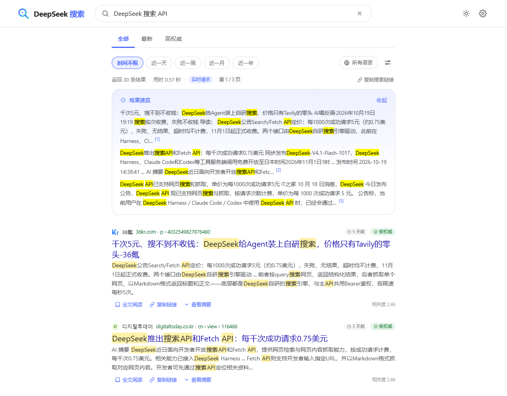
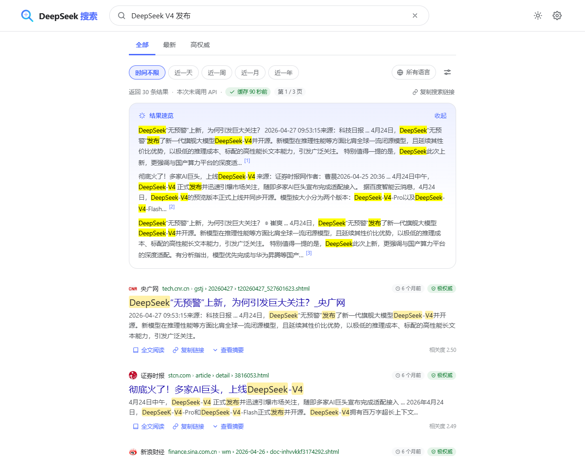
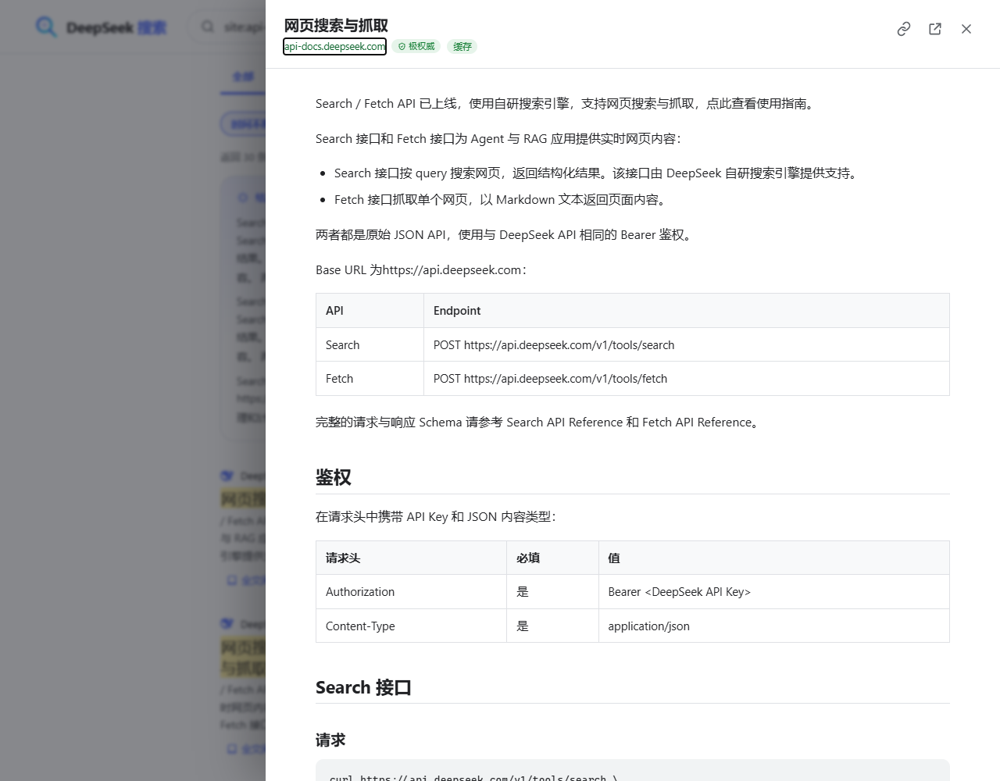

# DeepSeek 搜索

> 用 [DeepSeek 搜索 API](https://api-docs.deepseek.com/zh-cn/guides/search) 搭一个**给人用的**搜索引擎：Google 式的搜索体验 + 结果速览 + 全文阅读。
>
> 一个界面，两种用法：**单文件版**（双击本地 HTML，无需任何服务）和**本地服务版**（Node 代理，密钥不进浏览器）。
>
> 仓库：<https://github.com/148i00/deepseek-search>







## 从 GitHub 获取

```bash
git clone https://github.com/148i00/deepseek-search.git
cd deepseek-search

# 本地服务版（零运行时依赖，无需 npm install）
npm start

# 或者构建单文件版（构建完成后不再需要 Node）
npm run build:standalone
npm run build:standalone:personal
```

单文件版产物在 `dist/deepseek-search.html` / `dist/deepseek-search-personal.html`；`dist/` 已加入 `.gitignore`，不会被提交到仓库。

## 两种用法

### 方式 A：单文件版（无需本地服务，推荐日常使用）

构建一次，得到一个自包含的 `.html` 文件；**双击用 Chrome / Edge 打开即可搜索**，不需要 Node、不需要启动服务。

```bash
# 通用版：不含 Key，首次打开在设置里粘贴一次（保存在浏览器）
npm run build:standalone
# 产物：dist/deepseek-search.html

# 个人版：把本机 Key 直接嵌入 HTML，打开即用（等同于密钥文件，勿分享）
npm run build:standalone:personal
# 产物：dist/deepseek-search-personal.html
```

- 个人版在构建时按以下顺序找 Key：环境变量 `DEEPSEEK_API_KEY` → `~/.dsh/.credentials.yaml`；也可以用 `--key sk-...` 显式传入。
- 单文件版由浏览器直连 `https://api.deepseek.com`（已实测 DeepSeek API 允许 `file://` / `Origin: null` 的 CORS 请求），使用 hash 路由（`#/search?q=…`），Key 存在浏览器 `localStorage`。刷新、前进后退都能还原搜索。
- 已在 Edge（Chromium 内核）实测；Chrome 同内核预期可用，Firefox 未验证。
- 需要联网；不支持离线搜索。
- ⚠ 安全提示：个人版 HTML 里是**明文 Key**，请只放在自己电脑的私有目录；`file://` 的 `localStorage` 是共享来源，其他本地 HTML 可能读取到已保存的 Key。不要把个人版发给别人。如果同一浏览器里既保存过 Key、又使用带嵌入 Key 的个人版，**保存的 Key 优先**；个人版建议在专用浏览器配置中使用，或先在设置里清除已保存的密钥。

### 方式 B：本地服务版（开发调试、密钥不进浏览器）

要求 **Node.js 20+**（零运行时依赖，不需要 `npm install`）。

```bash
# 方式一：命令行
npm start

# 方式二：Windows 双击 start.cmd（会自动打开浏览器）
```

打开 <http://127.0.0.1:8787>，点击右上角齿轮或首页提示里的「去设置」填入 DeepSeek API Key。

> 默认端口 8787；如果被占用会自动尝试 8788–8806。也可以用 `PORT=9000 npm start` 或 `node server.mjs --port 9000` 指定。

服务版特点：Key 只留在本机服务端（`data/config.json`），接口不返回完整 Key；页面只监听回环地址，并校验 Host / Origin，防止其他网站跨站消耗 API 额度。

## 浏览器搜索引擎与书签

### 为什么 `file://` 不能设为默认搜索引擎

Chrome / Edge / Firefox 的自定义搜索引擎 URL 只接受 `http(s)`；`file://` 会被浏览器判为无效。**单文件版不能作为默认搜索引擎**，这是浏览器限制，不是页面本身能绕过的。

要把它变成地址栏搜索引擎，使用本地服务版的 URL：

```text
http://127.0.0.1:8787/search?q=%s
```

### 设为默认搜索引擎（本地服务版）

先确保 `npm start` 的服务在运行（默认 8787）。

**Edge**

1. 打开 `edge://settings/searchEngines`
2. 「管理搜索引擎」→ 添加：
   - 搜索引擎：`DeepSeek 搜索`
   - 快捷方式：`ds`
   - URL：`http://127.0.0.1:8787/search?q=%s`
3. 保存后在该条目右侧 `…` →「设为默认」；也可以在地址栏输入 `ds` → Tab/空格 → 关键词。

**Chrome**

1. 打开 `chrome://settings/searchEngines`
2. 「网站搜索 / 其他搜索引擎」→ 添加，名称 / 快捷字词 / URL 同上。
3. 如果条目 `…` 菜单里有「设为默认」就直接选；没有的话作为关键字搜索使用（`ds` + Tab + 关键词）。不同 Chrome 版本菜单略有差异，想直接设默认可以用 Edge。

**Firefox**

当前项目尚未提供 OpenSearch 描述文件。可以先用「书签关键词」方式；或把本地服务部署到 http(s) 地址后再添加。

### 开机自启（Windows，避免默认搜索引擎失效）

默认搜索引擎不会替你启动服务。最简做法：

1. `Win + R` 输入 `shell:startup` 回车
2. 新建快捷方式：
   - 目标：`"C:\Program Files\nodejs\node.exe" "C:\Users\<你>\Documents\Code\deepseek-search\server.mjs" --port 8787`
   - 起始位置：项目根目录
   - 名称：`DeepSeek 搜索服务`
3. 快捷方式属性 →「运行方式」选「最小化」。

> 端口必须保持 8787。当前服务如果发现 8787 被占用会自动尝试 8788–8806；一旦端口变化，上面的搜索引擎 URL 就会失效。启动后确认服务实际端口，或在启动前释放 8787。

### 书签关键词（单文件版 / 不想设为默认时）

**服务版书签**

- 书签网址：`http://127.0.0.1:8787/search?q=%s`
- 关键词：`ds`
- 地址栏输入 `ds` → Tab/空格 → 关键词。

**单文件版书签**

- 书签网址（把路径换成自己的实际路径）：
  ```text
  file:///C:/Users/<你>/Documents/Code/deepseek-search/dist/deepseek-search-personal.html#/search?q=%s
  ```
- 关键词：`ds`
- 地址栏输入 `ds` → Tab/空格 → 关键词。

单文件版只是普通本地网页，能用书签关键词快速打开；它**不能**替代浏览器默认搜索引擎。若坚持不启动服务，也可以把页面部署到自己的 http(s) 静态空间（注意个人版不要上传，通用版由使用者自行填写 Key）。

## 功能

- **Google 式搜索体验**：首页大搜索框、结果页顶部搜索栏、标签页（全部 / 最新 / 高权威）、时间范围筛选、语言筛选、分页、回车即搜、`/` 聚焦搜索。
- **结果速览**：把前几条结果的长摘要整理成带引用编号的速览卡片（可在设置中关闭；窄屏默认折叠）。
- **全文阅读器**：点击「全文阅读」调用 DeepSeek Fetch 接口，把网页正文渲染成带标题层级、表格、代码块、列表和图片的阅读视图，无需离开搜索页。
- **搜索语法**：完整支持 `site:`、`-site:`、`-词`、`"短语"`、`-"短语"`、`lang:`、`after:`、`before:`；高级搜索面板可以可视化拼出这些查询。
- **省钱的本地缓存**：相同查询 5 分钟内只调用一次 Search API；同一网页的全文 30 分钟内只抓取一次（可在设置中清空缓存）。服务版缓存在进程内，单文件版缓存在浏览器内。
- **搜索历史 / 最近搜索建议**：本地保存，可一键清除。
- **深色模式**、响应式移动端布局、键盘导航（`J`/`K` 选中、`Enter` 阅读全文）。
- **两种模式共享同一套 UI / 逻辑**：前端通过统一的 `backend.request('/api/*')` 适配层切换服务端代理或浏览器直连，行为与错误提示一致。

## 搜索语法

直接在搜索框输入，操作符可以组合。表格式帮助在页面里按 `?` 或点击「搜索语法与快捷键」查看。

| 语法 | 作用 | 示例 |
| --- | --- | --- |
| `site:` | 限定站点 | `DeepSeek site:github.com` |
| `-site:` | 排除站点 | `DeepSeek -site:csdn.net` |
| `-词` | 排除包含该词的网页 | `DeepSeek -广告` |
| `"短语"` | 精确匹配 | `DeepSeek "开源模型"` |
| `-"短语"` | 排除短语 | `DeepSeek -"release notes"` |
| `lang:` | 限定语言（逗号分隔） | `DeepSeek lang:zh,en` |
| `after:` | 发布日期之后 | `DeepSeek after:2025-01-01` |
| `before:` | 发布日期之前 | `DeepSeek before:2026` |

时间筛选（近一天 / 一周 / 一月 / 一年）会在查询末尾自动追加 `after:YYYY-MM-DD`；语言筛选会自动追加 `lang:xx`，不会重复添加你已经写过的操作符。

### 快捷键

| 按键 | 功能 |
| --- | --- |
| `/` | 聚焦搜索框 |
| `Esc` | 关闭阅读器 / 对话框 / 建议列表 |
| `J` / `K` | 在结果间上下移动 |
| `Enter` / `O` | 打开选中结果的全文阅读 |
| `?` | 打开帮助 |

## 它是怎么工作的

```text
方式 A：单文件版（file://）
  双击 HTML
    └─ 内联 CSS/JS（打包后的同一套前端）
         └─ backend-direct：浏览器直接 POST https://api.deepseek.com/v1/tools/*
              ├─ Search：5 分钟客户端缓存
              ├─ Fetch：30 分钟客户端缓存
              └─ Key：localStorage（或个人版构建时嵌入）
         路由：hash（#/search?q=…），刷新 / 前进后退可还原

方式 B：本地服务版（http://127.0.0.1:8787）
  浏览器（原生 ES Module，无框架）
    └─ backend-server：只调用本机 /api/*
         │
  Node 服务（server.mjs，零依赖）
    ├─ /api/search   → https://api.deepseek.com/v1/tools/search（带 5 分钟缓存）
    ├─ /api/fetch    → https://api.deepseek.com/v1/tools/fetch（带 30 分钟缓存）
    ├─ /api/settings → 保存密钥到 data/config.json
    ├─ /api/test     → 用一次真实请求验证密钥
    └─ /api/status   → 配置状态、密钥掩码、缓存统计（不泄露密钥）
          │
  DeepSeek API（Bearer 鉴权）
```

目录结构：

```text
.
├─ server.mjs                # 服务版 HTTP 服务：静态资源 + API 代理 + 安全头
├─ src/
│  ├─ deepseek.mjs           # re-export shim → public/js/deepseek-client.js
│  ├─ cache.mjs              # re-export shim → public/js/cache.js
│  └─ config.mjs             # 服务版密钥解析优先级 + data/config.json 读写
├─ public/
│  ├─ index.html             # 单页应用外壳（也是单文件构建模板）
│  ├─ styles.css             # 设计系统（浅色/深色、响应式）
│  └─ js/
│     ├─ app.js              # 路由、搜索流程、结果渲染、阅读器、设置、快捷键
│     ├─ backend.js          # 服务版 / 直连版后端选择
│     ├─ backend-server.js   # 调用本机 /api/*
│     ├─ backend-direct.js   # 单文件版：浏览器直连 DeepSeek + 本地缓存 + 本地 Key
│     ├─ deepseek-client.js  # Search / Fetch 客户端（校验、重试、错误归一化，共享）
│     ├─ cache.js            # TTL + LRU 缓存（共享）
│     ├─ key-utils.js        # 密钥格式校验 / 掩码（共享）
│     ├─ routing.js          # path / hash 双模式路由
│     ├─ query.js            # 搜索语法解析 / 构造 / 高亮词
│     ├─ markdown.js         # 安全 Markdown 渲染（用于全文阅读）
│     ├─ util.js             # 转义、URL、日期、高亮等工具
│     └─ theme-boot.js       # 首帧前应用主题，避免闪烁
├─ scripts/
│  ├─ check-api.mjs          # 命令行验证 Key / 搜索 / 抓取
│  └─ build-standalone.mjs   # 单文件版构建器（零依赖）
├─ test/                     # node:test：单元 + 服务端集成 + 构建测试
├─ tools/e2e/
│  ├─ smoke.mjs              # 服务版端到端（Playwright + 本机 Edge）
│  └─ standalone.mjs         # 单文件版端到端（真实 file://）
├─ dist/                     # 单文件版产物（含 personal 密钥文件，已 gitignore）
└─ data/                     # 服务版运行时 config.json（含密钥，已 gitignore）
```

### 内部接口

服务版与单文件版共用同一个前端后端契约：

```js
backend.request('/api/status');
backend.request('/api/search', { query, count }, { signal });
backend.request('/api/fetch', { url });
backend.request('/api/settings', { apiKey });
backend.request('/api/test', {});
backend.request('/api/cache', undefined, { method: 'DELETE' });
```

服务端（`server.mjs`）提供同名 HTTP 接口：

| 方法 | 路径 | 说明 |
| --- | --- | --- |
| `GET` | `/api/status` | 配置状态、密钥来源与掩码、缓存/请求统计 |
| `POST` | `/api/search` | `{ query, count, oriQuestion? }`，返回归一化后的 `results` 与 `meta` |
| `POST` | `/api/fetch` | `{ url }`，返回 `{ title, content }`（Markdown） |
| `POST` | `/api/settings` | `{ apiKey?, defaultCount? }`，保存/清除本机密钥 |
| `POST` | `/api/test` | 用一次真实 Search 请求验证密钥 |
| `DELETE` | `/api/cache` | 清空本地缓存 |
| `GET` | `/api/health` | 存活探测 |

## 计费与隐私

- **计费**：DeepSeek Search / Fetch 按**成功请求次数**计费（每 1,000 次 5 元，失败 / 无结果不计费）。本项目只在真正搜索 / 阅读全文时各发一次请求；重复查询命中缓存不会再计费。设置里的「测试连接」会真实调用一次 Search（约 ¥0.005）。
- **服务版隐私**：只监听 `127.0.0.1`，不开放局域网；页面无第三方脚本 / 统计 / 字体 CDN；搜索历史只存在浏览器 `localStorage`；密钥只存在本机服务端，接口只返回掩码。查询内容会发送给 DeepSeek API——这是搜索引擎本身的工作方式。
- **单文件版隐私**：没有本地服务；页面直接请求 `https://api.deepseek.com`（CSP 的 `connect-src` 只允许这个地址；站点图标和正文图片仍会从结果站点加载任意 HTTPS 图片）；搜索历史 / 设置 / Key 存在浏览器 `localStorage`（个人版 Key 还可以来自 HTML 内嵌）。同样没有第三方脚本或统计。

## 测试

```bash
npm test                     # 85 个单元 / 集成 / 构建测试（使用假上游，不花钱）
```

端到端测试（需要本机 Edge 和一次 `playwright-core` 安装，**会真实调用少量 API**）：

```bash
# 安装一次 E2E 依赖
cd tools/e2e && npm install --no-audit --no-fund && cd ../..

# 服务版 E2E：先 npm start，然后
npm run e2e

# 单文件版 E2E：会自动构建 personal + generic 两个 HTML，再通过真实 file:// 打开验证
# 需要本机有可用 Key（自动从 DEEPSEEK_API_KEY / ~/.dsh 凭据读取，用于构建 personal 版）
npm run test:standalone
```

覆盖范围：

- 服务版：首页、搜索、排序、时间筛选、分页、文档页 Markdown 阅读、键盘导航、设置 + 测试连接、深色模式、高级搜索、空结果、搜索建议、移动端。
- 单文件版：`file://` 协议、无本地服务、hash 路由、阅读器直连 Fetch、嵌入 Key 来源、无 Key 引导、粘贴 Key → 保存 → 自动重试搜索、刷新恢复、禁用 localStorage 降级、无 `127.0.0.1` 请求。
- 截图写入 `docs/screenshots/`。

命令行自查：

```bash
node scripts/check-api.mjs "DeepSeek V4"
```

## 已知限制

- Search API 单次最多返回 **50** 条、没有 offset 参数。因此分页是在一次请求返回的 30 条（可在设置里调整为 10–50 条）结果内分页；「第 1/3 页」是本地页，而不是服务端结果集。
- Search 不返回「总结果数」，界面显示的是“返回 N 条结果”。
- Fetch 返回的 Markdown 是站点内容压平后的结果，结构和样式不可能还原到原站 100%；阅读器已针对标题、表格、列表、代码块做启发式还原。
- 部分站点的全文抓取会被目标站点策略拦截（HTTP 404 / 403），此时阅读器会提供「直接打开原文」。
- 某些站点图标会被浏览器 ORB 策略拦截，此时自动降级为域名首字母图标。
- 单文件版依赖 DeepSeek API 的 CORS 策略（当前允许 `Origin: null`）。如果网络 / 浏览器 / API 策略拦截，页面会提示改用本地服务版。
- 单文件版无法自动读取 `~/.dsh/.credentials.yaml`（浏览器不能读本地文件），所以通用版首次需要手动粘贴 Key；个人版是在**构建时**读取并嵌入。
- `file://` 的 `localStorage` 是共享来源，不要把个人版和不明来源的本地 HTML 放在一起使用；个人版 HTML 本身就是密钥文件。
- 本项目没有实现图片搜索 / 新闻搜索（DeepSeek API 暂不提供对应接口）。

## License

仅供个人学习与自用；使用前请遵守 [DeepSeek API 服务条款](https://platform.deepseek.com/)。
